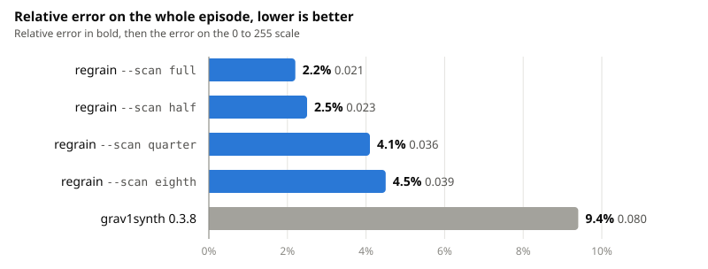
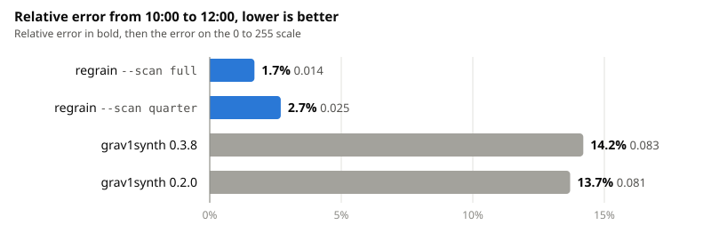
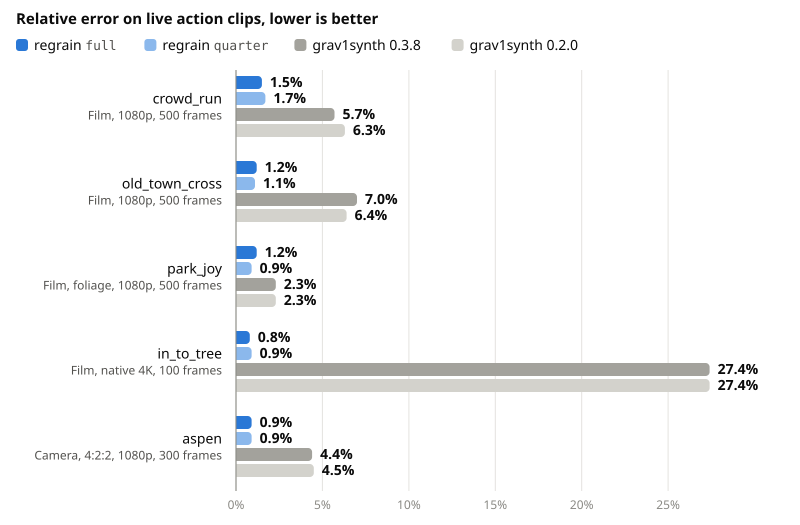
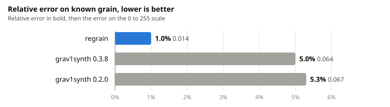
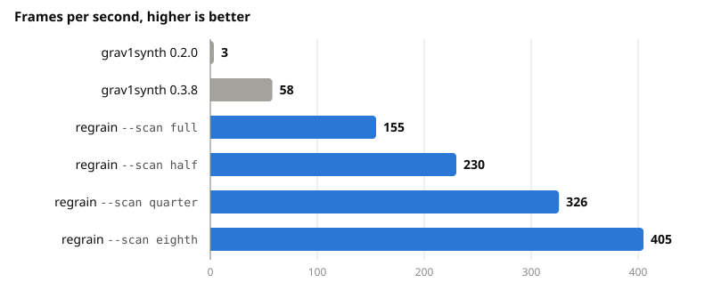
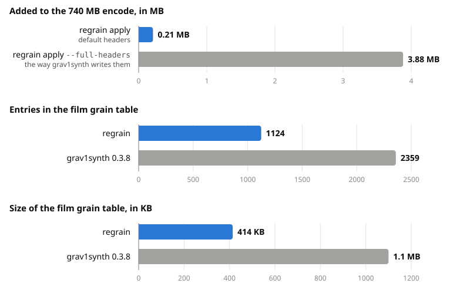

# regrain

regrain measures the film grain a denoiser removed from a video and puts it back as AV1 film grain synthesis. The grain is not encoded as picture detail. It is stored as a small set of parameters and the player draws it again, so the encode stays small and still looks like the source.

| Command       | What it does                                                                        |
| ------------- | ----------------------------------------------------------------------------------- |
| `diff`        | Compares the original video with its denoised version and writes a film grain table |
| `apply`       | Writes a film grain table into an AV1 video                                         |
| `export`      | Reads the film grain table out of an AV1 video                                      |
| `remove`      | Removes film grain synthesis from an AV1 video                                      |
| `stats`       | Shows what a film grain table holds, entry by entry                                 |
| `completions` | Prints a completion script for bash, zsh, fish, elvish or PowerShell                |
| `manual`      | Prints the manual page in roff format                                               |

Tables use the `filmgrn1` text format that libaom, SVT-AV1 and grav1synth also read and write.

## Typical workflow

```sh
# 1. Denoise the source with any denoiser and keep the result lossless.
# 2. Measure what the denoiser removed.
regrain diff original.mkv denoised.mkv -o grain.tbl

# 3. Encode the denoised video to AV1 with any encoder, without film grain.
# 4. Put the measured grain into the encode.
regrain apply encode.ivf -o final.ivf --table grain.tbl
```

Every scene gets its own table entry, and `apply` gives every frame the entry of the scene it is shown in.

## Installing

Download an archive for your system from the [releases page](https://github.com/Rabbit-Company/regrain/releases). Each one holds the `regrain` binary, this README, the changelog and the licence. The binaries need no libraries beyond what the system ships with.

| Archive           | System                                                                               |
| ----------------- | ------------------------------------------------------------------------------------ |
| `linux-x86_64-v3` | Linux on Intel Haswell (2013), AMD Excavator (2015) or newer. Pick this when unsure  |
| `linux-x86_64-v4` | Linux on CPUs with AVX-512, such as AMD Zen 4 or newer and Intel Xeon                |
| `linux-x86_64-v2` | Linux on older x86-64 CPUs that the v3 build does not run on                         |
| `linux-aarch64`   | Linux on 64 bit ARM, such as a Raspberry Pi 4 or 5 with a 64 bit OS, or AWS Graviton |
| `macos-aarch64`   | macOS on Apple silicon (M1 and newer)                                                |
| `macos-x86_64`    | macOS on Intel                                                                       |
| `windows-x86_64`  | Windows on x86-64                                                                    |

The v2, v3 and v4 Linux builds differ only in the CPU instructions they may use. To see which levels your CPU supports:

```sh
/lib64/ld-linux-x86-64.so.2 --help | grep supported
```

A build that is too new for the CPU crashes with an illegal instruction error and does no other harm, so trying v3 first is safe.

On Linux and macOS:

```sh
tar -xzf regrain-v0.1.0-linux-x86_64-v3.tar.gz
sudo install regrain-v0.1.0-linux-x86_64-v3/regrain /usr/local/bin/
```

The macOS binaries are not signed. If macOS refuses to open it, clear the quarantine flag once:

```sh
xattr -d com.apple.quarantine /usr/local/bin/regrain
```

On Windows, unpack the zip and put `regrain.exe` in a folder on the `PATH`.

`SHA256SUMS` on the releases page lists the checksum of every archive:

```sh
sha256sum --check --ignore-missing SHA256SUMS
```

On macOS, use `shasum -a 256 --check --ignore-missing SHA256SUMS`.

To install the manual and completions:

```sh
regrain manual > /usr/local/share/man/man1/regrain.1
regrain completions bash > /etc/bash_completion.d/regrain
```

## Building

```sh
cargo build --release
```

The binary is `target/release/regrain`. It has no library dependencies.

Building for the local CPU with `-C target-cpu=native` made no measurable difference, because decoding the videos takes most of the time.

## Requirements

`diff` needs `ffmpeg` and `ffprobe` to decode the two videos. `apply`, `export` and `remove` read and write IVF, low overhead OBU streams and Annex B without any other program, and use `ffmpeg` only to read or write MKV, WebM and MP4. Pass `--ffmpeg <path>` when `ffmpeg` is not on the `PATH`. `ffprobe` is expected next to it.

## diff

```sh
regrain diff <SOURCE> <DENOISED> -o <TABLE>
```

`SOURCE` is the original video with grain. `DENOISED` is the same video after denoising, or `-` to read it as y4m from standard input. Both must have the same constant frame rate and start on the same frame. regrain checks both: it stops with `variable_frame_rate` when the frame timestamps are irregular, and with `misaligned` when the moving parts of the pictures match better one frame apart.

| Option                                 | Default     | Meaning                                                                                 |
| -------------------------------------- | ----------- | --------------------------------------------------------------------------------------- |
| `--scan <full\|half\|quarter\|eighth>` | `full`      | How much of the video to measure. See below                                             |
| `-j, --threads <N>`                    | all threads | Worker threads                                                                          |
| `--no-chroma`                          | off         | Measure luma grain only                                                                 |
| `--crop <W:H:X:Y>`                     | none        | Area of the source that the denoised video covers, when the denoised video was cropped  |
| `--start <SECONDS>`                    | 0           | Start measuring this far into both videos                                               |
| `--duration <SECONDS>`                 | whole video | Measure only this much                                                                  |
| `--scene-threshold <N>`                | 4           | Brightness change between frames that starts a new scene, on a 0 to 255 scale           |
| `--merge <N>`                          | 0.08        | How alike neighbouring scenes must be to share one table entry, from 0 to 1             |
| `--output-depth <8\|10\|12>`           | 10          | Bit depth of the AV1 encode the grain will be added to                                  |
| `--strict`                             | off         | Fail with `frames_differ` instead of warning when many frames differ between the videos |
| `-v, --verbose`                        | off         | Print what was measured for every scene                                                 |
| `-y, --overwrite`                      | off         | Replace an existing output file                                                         |

Table timestamps start at zero at the first measured frame. With `--start`, the table describes the measured range and not the whole video.

A denoiser can pipe its output straight into `diff`, without a lossless file in between:

```sh
denoiser original.mkv --output - | regrain diff original.mkv - -o grain.tbl
```

Standard input can only be read once, so the whole video is one stretch for a single worker. Sampled scans read and drop the frames they skip. `--start` then applies to the source only, and the y4m stream is expected to begin at that point. The table is the same as with the denoised video in a file.

### Scan modes

Decoding the two videos takes most of the time, so the faster modes decode less. They read the first frames of every 48 frame period.

| Mode      | Frames read per 48 | Scene boundaries |
| --------- | ------------------ | ---------------- |
| `full`    | 48                 | Exact            |
| `half`    | 24                 | Within 12 frames |
| `quarter` | 12                 | Within 18 frames |
| `eighth`  | 6                  | Within 21 frames |

A sampled scan still measures every scene that is longer than the gap between samples. A scene change that falls into a gap is placed in the middle of that gap.

Intra only formats such as FFV1, ProRes and DNxHD are seeked directly, so a quarter scan decodes a quarter of the frames. Formats with long GOPs such as H.264 and HEVC have to be decoded in full, and only the analysis is skipped.

The table is the same for every thread count.

### How the grain is measured

1. Both videos are decoded at their native bit depth. Nothing is reduced to 8 bit.
2. Each frame is split into 32 by 32 blocks. A block is used when the denoised picture in it is flat, so that the difference holds grain and not removed detail. Strictly flat blocks vary by less than about 1.4 levels on the 0 to 255 scale. Loosely flat blocks are within three times the flattest tenth of the frame, and are only used for a scene with fewer than 100 strictly flat blocks, such as one full of foliage, or after a denoiser that left noise everywhere. Chroma blocks also need flat luma, because denoisers change colour along luma edges.
3. For every scene, regrain collects how strong the grain is at each brightness and how neighbouring grain pixels relate to each other.
4. The strength at each brightness is the mean over all blocks of the scene. Blocks more than 8 times above the median are left out, since those almost always hold removed detail.
5. The decoder rounds the grain it adds to whole code values of the encode, which adds a little noise of its own. regrain takes that away from the target, at the bit depth given by `--output-depth`.
6. The grain pattern is fitted as an AV1 autoregressive filter with the smallest lag that describes it.
7. regrain then builds the grain the way an AV1 decoder does and measures it, and sets the scaling values so the decoder output has the measured strength.
8. Neighbouring scenes with the same grain share one table entry.

Blocks where the source is perfectly constant, such as letterbox bars, are not measured. An AV1 decoder gives every brightness below the darkest scaling point the grain of that point, so when such blocks are darker than everything measured, the grain is set to zero at their level and one level above it, and comes back in full one level further up. Constant blocks brighter than everything measured are handled the same way. Bars and black frames then stay clean.

## apply

```sh
regrain apply <INPUT> -o <OUTPUT> --table <TABLE>
```

| Option            | Meaning                                                                                           |
| ----------------- | ------------------------------------------------------------------------------------------------- |
| `--full-headers`  | Write every frame's parameters in full instead of pointing at a reference frame                   |
| `--verify`        | Read the output back and decode it with dav1d before keeping it                                   |
| `--fps <RATE>`    | Frame rate for streams without timestamps, such as OBU and Annex B files, as `24000/1001` or `25` |
| `-y, --overwrite` | Replace an existing output file                                                                   |

The output format follows the extension. `.ivf` is written directly, and so is `.obu`, as Annex B when the input was Annex B and as a low overhead stream otherwise. For `.mkv`, `.webm` and `.mp4`, regrain first writes the video to a temporary IVF file and then lets ffmpeg mux it with the other tracks of the input, so ffmpeg interleaves them by time.

OBU and Annex B streams carry no timestamps. regrain then takes the frame rate from the timing info in the sequence header, from `--fps`, or uses 24000/1001.

The output is written under a temporary name and only takes its real name when everything succeeded.

With `--verify`, regrain parses the written stream again, checks that every shown frame carries the grain the table gives it and that the grain follows every AV1 rule, and decodes the whole output with dav1d through ffmpeg. Messages the decoder also prints for the input are not counted against the output. Verifying adds about a minute per 1080p episode.

An empty table gives the input without grain, the same as `remove`.

Only frame headers are rewritten. The picture data is copied, so the step takes about a second per episode. Grain that is already in the video is replaced.

Frames between table entries, and frames after the last entry when it has an end time, get no grain. A frame that is decoded early and shown later gets the entry of the time it is shown.

By default a frame that uses the same parameters as one of its reference frames stores only a new seed and a pointer to that frame. This is standard AV1 and decodes to the same picture as full headers, with a fraction of the size.

When the input is not an IVF file and the output is MKV, WebM or MP4, audio, subtitles, attachments and chapters are copied from the input.

Tables from any tool are adjusted where AV1 requires it. For example, in 4:2:0 video both chroma planes must have grain or neither may, so a plane without an entry gets one at zero strength.

## export

```sh
regrain export <INPUT> -o <TABLE>
```

Consecutive frames with the same parameters become one table entry. A table exported from a video that regrain wrote is identical to the table that was applied.

## remove

```sh
regrain remove <INPUT> -o <OUTPUT>
```

Removing the grain from a video that regrain wrote gives back the original file byte for byte when that file had no grain. `--verify` and `--fps` work as for `apply`.

## stats

```sh
regrain stats <TABLE>
```

Prints every entry with its start and end time and the grain an AV1 decoder will produce for it, on the 0 to 255 scale: luma at brightness 32, 128 and 224, luma on average, Cb and Cr on average, the filter lag, and how alike neighbouring grain pixels are. The strength comes from building the grain template the way a decoder does, so it accounts for the autoregressive filter.

```
       start          end   dark    mid bright   luma     cb     cr  lag   corr
    0:00.000     0:03.879  1.313  1.248  0.960  1.183  1.011  0.350    2   0.43
    0:03.879     0:07.508  1.133  1.820  1.856  1.718  1.298  0.603    3   0.39
```

## Machine readable output

Every command accepts `--progress <text|json|none>`. `-q` is the same as `--progress none`.

With `--progress json`, regrain writes one JSON object per line to standard output and nothing else there. Messages from ffmpeg still go to standard error. Every object has an `event` field:

| Event      | Sent by       | When                          |
| ---------- | ------------- | ----------------------------- |
| `start`    | `diff`        | After both videos were probed |
| `progress` | `diff`        | About twice a second          |
| `summary`  | every command | When the command succeeded    |
| `error`    | every command | When the command failed       |

```json
{"event":"start","command":"diff","frames":720,"width":1440,"height":1080,"bit_depth":8,"fps":23.976,"scan":"quarter","threads":16}
{"event":"progress","frames":312,"total":720,"percent":43.333,"fps":71.5,"elapsed_seconds":4.364,"eta_seconds":6}
{"event":"summary","command":"diff","output":"grain.tbl","frames":720,"frames_expected":720,"scenes":38,"entries":38,"mismatched_frames":0,"luma_deviation":0.824,"scan":"quarter","threads":16,"fps":94.26,"seconds":7.638,"timings":{"probe_seconds":0.185,"measure_seconds":7.217,"fit_seconds":0.236},"warnings":[]}
{"event":"error","code":"size_mismatch","message":"the source is 1440x1080 and the denoised video is 1408x1080, use --crop to cut the source to the same area"}
```

In `start` and `progress`, `frames` and `total` count the frames the chosen scan will measure. Values that are not known are `null`.

Summary fields:

| Command  | Fields                                                                                                                                                        |
| -------- | ------------------------------------------------------------------------------------------------------------------------------------------------------------- |
| `diff`   | `output`, `frames`, `frames_expected`, `scenes`, `entries`, `mismatched_frames`, `luma_deviation`, `scan`, `threads`, `fps`, `seconds`, `timings`, `warnings` |
| `apply`  | `output`, `frames`, `grained_frames`, `entries`, `replaced_existing_grain`, `empty_table`, `verified`, `input_bytes`, `output_bytes`, `seconds`               |
| `export` | `output`, `frames`, `entries`, `seconds`                                                                                                                      |
| `remove` | `output`, `frames`, `had_grain`, `verified`, `input_bytes`, `output_bytes`, `seconds`                                                                         |
| `stats`  | `entries`, `luma`, `list` with `start_seconds`, `end_seconds`, `luma_dark`, `luma_mid`, `luma_bright`, `luma`, `cb`, `cr`, `lag`, `correlation` per entry     |

`warnings` is a list of objects with a `code` and a `message`. The codes are `frames_differ`, when many frames do not match between the two videos, and `no_grain`, when the table is empty.

The exit code is 0 on success, 130 when cancelled with Ctrl+C or SIGTERM, and 1 for every other failure. Error codes:

| Code                   | Meaning                                                                                            |
| ---------------------- | -------------------------------------------------------------------------------------------------- |
| `input_not_found`      | An input video does not exist                                                                      |
| `table_not_found`      | The table passed to `apply` cannot be read                                                         |
| `invalid_table`        | The table is not a valid film grain table                                                          |
| `output_exists`        | The output exists and `--overwrite` was not given                                                  |
| `output_is_input`      | The output path is one of the inputs                                                               |
| `same_input`           | `diff` was given the same file twice                                                               |
| `invalid_argument`     | An option value is not usable, such as a malformed `--crop` or a `--start` past the end            |
| `unsupported_input`    | The input is not a video regrain can read, or not AV1 where AV1 is needed                          |
| `unsupported_output`   | The output extension is not supported                                                              |
| `invalid_bitstream`    | The AV1 stream could not be parsed                                                                 |
| `frame_rate_mismatch`  | The two videos of `diff` have different frame rates                                                |
| `size_mismatch`        | The source does not match the denoised picture size, even after `--crop`                           |
| `frame_count_mismatch` | The two videos of `diff` have different frame counts                                               |
| `variable_frame_rate`  | One of the videos of `diff` has a variable frame rate                                              |
| `misaligned`           | The two videos of `diff` are off by at least one frame, or could not be read at matching positions |
| `frames_differ`        | With `--strict`, many frames differ between the two videos of `diff`                               |
| `verify_failed`        | `--verify` found a frame with the wrong grain, or dav1d could not decode the output                |
| `verify_unavailable`   | `--verify` needs ffmpeg with the libdav1d decoder                                                  |
| `cancelled`            | Ctrl+C or SIGTERM stopped the command. ffmpeg is stopped and partial output removed                |
| `no_frames`            | No frames could be read                                                                            |
| `ffmpeg_missing`       | ffmpeg or ffprobe could not be started                                                             |
| `ffmpeg_failed`        | ffmpeg stopped with an error                                                                       |
| `io_error`             | A file could not be read, written or moved                                                         |
| `error`                | Anything else                                                                                      |

The text of `message` may change between versions. The codes and field names will not.

## Measurements

The main test video is one episode of Magic Knight Rayearth (1994) from Blu-ray: 34896 frames at 23.976 fps. The original is a 1920x1080 8 bit H.264 remux with the 4:3 picture between black side bars. The denoised video is a 1440x1080 8 bit FFV1 file, so `diff` ran with `--crop 1440:1080:240:0`. The denoised video was encoded with SVT-AV1 at preset 6 and CRF 28 in 10 bit, and every table was applied to that same encode with `regrain apply`.

grav1synth 0.2.0 is the current upstream release. grav1synth 0.3.8 is the Rabbit Company fork. Both use the same measuring method.

The computer has an AMD Ryzen 7 7840HS with 8 cores and 16 threads.

### Accuracy on the episode

The grained encode was decoded with dav1d at full precision, and the grain the decoder added was compared with the grain the denoiser removed. Only flat areas are compared, so that removed detail does not count as grain. The error is the mean difference in grain deviation for every 10 second stretch and brightness level, on a 0 to 255 scale, and the relative error is that difference divided by the removed grain. Lower is better. The scripts are in `scripts/`, see [Testing](#testing).



grav1synth 0.2.0 needs about three hours for the whole episode, so all tools were also compared on two minutes of it, from 10:00 to 12:00:



### Live action

Five clips from the [Xiph test media](https://media.xiph.org/video/derf/): four from the SVT high definition set, shot on 65 mm film, and one from a digital camera in 4:2:2. Each was denoised with av-denoise NL4D at its defaults and encoded with SVT-AV1 at preset 8 and CRF 28 in 10 bit, or with libaom for the 4:2:2 clip. The clip from the camera was compared on luma only.



On these short clips a full scan ran at 105 to 142 frames per second at 1080p and 33 at 4K, against 49 to 115 and 23 for grav1synth 0.3.8.

### Known grain

Synthetic AV1 grain with known parameters was added to 480 frames of a 1080p 10 bit video, and each tool measured it back.



grav1synth measures 10 bit video after reducing it to 8 bit, which adds rounding noise to what it measures.

The same known grain test was run for every format AV1 allows, on 960x540 video and on 4K. regrain measured it back with a relative error between 0.9% and 1.3% for 8, 10 and 12 bit, for 4:2:0, 4:2:2 and 4:4:4, for monochrome video, and for 4K.

### Speed

Frames of the episode processed per second. Higher is better.



For the whole episode, regrain takes 225 seconds with `--scan full` and 86 seconds with `--scan eighth`.

grav1synth 0.2.0 runs on one thread. Its crop filter fails on this video and it cannot read frames 1440 pixels wide, so it was given lossless copies of both videos cut to 1408 pixels. The rate above comes from the first half of the episode, which took 97 minutes. On the two minute stretch it managed 3.3 frames per second.

The speed is the same for every thread count. Decoding FFV1 takes most of the CPU time in a full scan.

Peak memory was 185 MB for 1080p and 1.2 GB for 4K with 16 threads. Very large frames get fewer workers, so memory stays within about 3 GB.

### Size



## Testing

`cargo test` runs the unit and integration tests. The integration tests need ffmpeg with libsvtav1 or libaom and libdav1d, and are skipped without them.

`scripts/conformance.sh <folder>` runs `export`, `remove --verify` and `apply --verify` on every AV1 stream below a folder, and checks that the decoded pictures without grain stay identical. It passes on all 242 libaom test vectors and on all 744 streams in the dav1d test data that ffmpeg can decode, including Annex B and low overhead OBU streams from the Argon suite.

`REGRAIN_FUZZ_DIR=<folder> REGRAIN_FUZZ_ROUNDS=<n> cargo test --release damaged_streams` feeds damaged copies of every IVF file in a folder through the parser and the rewriter. 4.84 million damaged copies of the libaom vectors caused no panic.

`scripts/accuracy.py` produced the accuracy numbers above and `scripts/speed.sh` the speed numbers. `scripts/charts.py` draws the charts from them.

## Limits

- Both inputs of `diff` need the same constant frame rate and the same frame alignment. regrain refuses variable frame rate and stops when the videos are off by a frame.
- `diff` needs flat areas to measure grain. A scene without any takes the values of the scene before it.
- The AV1 grain model allows 14 brightness points for luma, 10 for chroma, and a filter that reaches 3 pixels. Grain that is coarser than that cannot be reproduced exactly.
- MKV, WebM and MP4 are read and written through ffmpeg. Writing them needs free space for a temporary copy of the video track.
- No HDR source has been measured yet.
- SVT-AV1 reads only the first entry of a table passed as `--fgs-table`. Use `regrain apply` on the finished encode to keep every scene's own grain.

## Licence

MIT, see [LICENSE](LICENSE).
